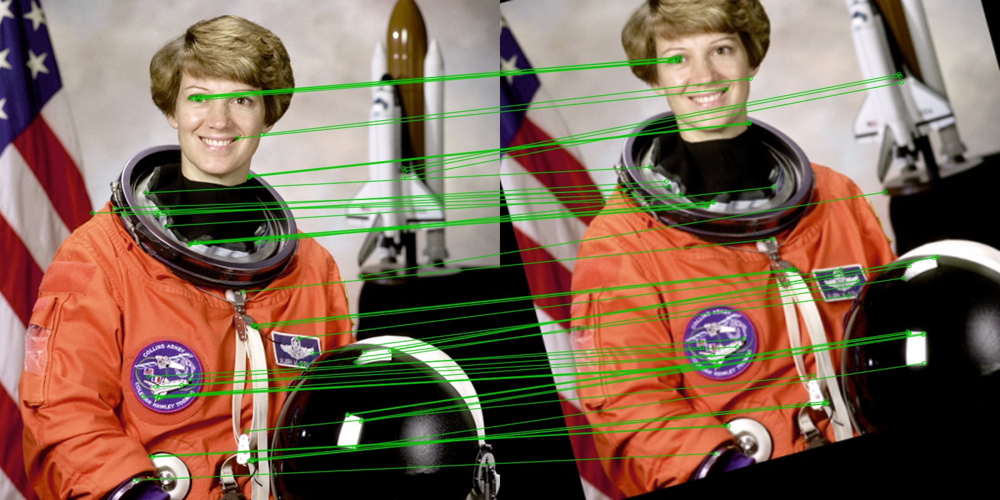
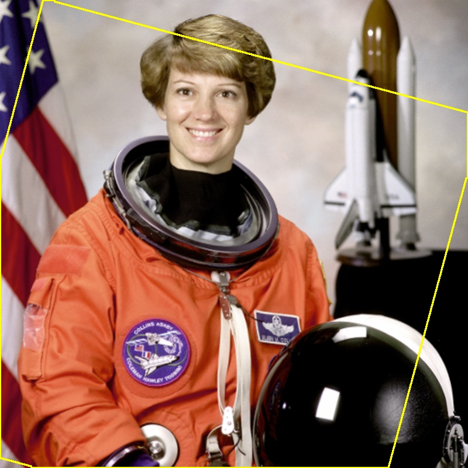

# Image Similarity Detection

Image Processing course project (2026) — **Ahmet Mert Mete** (220218023) & **Adnan Efe Koç** (220218037)

Compares two images and returns a **similarity score from 0 to 100** that stays meaningful when one of them is rotated, resized, cropped, recompressed or lightly edited. The tool also explains *why* two images match by drawing the matched keypoints and the aligned overlay.



## Pipeline

```
Preprocessing → ORB keypoints → Matching + RANSAC alignment → SSIM + histogram → Weighted score
```

1. **Preprocessing** – both images are resized to a max side of 800 px (aspect ratio kept); grayscale copies are used for keypoints.
2. **ORB keypoints** – up to 2000 ORB features per image (OpenCV).
3. **Matching** – brute-force Hamming matching with **Lowe's ratio test** (0.75).
4. **RANSAC alignment** – homography estimated with RANSAC; image B is warped onto image A. Degenerate homographies (flips, extreme scale, strong perspective) are rejected.
5. **SSIM** – computed **only inside the overlapping region** of the aligned images.
6. **HSV histogram** – correlation of H‑S and V histograms of the original colour images.
7. **Score**

```
score = 100 × (0.5 × inlier_ratio + 0.3 × SSIM + 0.2 × histogram_correlation)
```

**Fallback:** if fewer than 10 good matches / inliers are found or no valid homography exists, alignment is skipped and the score is **capped at 20**, so colour similarity alone cannot make unrelated images look alike.



## Project structure

```
similarity/
  preprocessing.py   resize, grayscale, load/decode
  alignment.py       ORB, ratio test, RANSAC homography, warping
  metrics.py         masked SSIM, HSV histogram correlation
  baselines.py       pixel-wise MSE and pHash baselines
  pipeline.py        compare_images(), weighted score, visualisations
evaluation/
  make_dataset.py    builds the transformed test set + pairs.csv
  evaluate.py        precision / recall / F1, per-transformation results, weight tuning
tests/               pytest unit tests
app.py               Streamlit interface
results/             latest evaluation output (CSV)
```

## Setup

```bash
python -m venv .venv
# Windows: .venv\Scripts\activate    macOS/Linux: source .venv/bin/activate
pip install -r requirements.txt
```

## Usage

**Web interface**

```bash
streamlit run app.py
```

Upload an original and a second image; the app shows the score, its components, both baselines, the matched keypoints and the aligned overlay. Weights and the duplicate threshold can be changed from the sidebar.

**Python**

```python
from similarity import compare_images
from similarity.preprocessing import load_image

res = compare_images(load_image("a.jpg"), load_image("b.jpg"))
print(res.as_dict())   # score, inlier_ratio, ssim, hist_corr, aligned, ...
```

## Evaluation

```bash
# Build the test set from your own originals (put ~50 images in data/originals/)
python -m evaluation.make_dataset --originals data/originals --out data/eval
# ...or from scikit-image's built-in sample images
python -m evaluation.make_dataset --use-samples --out data/eval

python -m evaluation.evaluate --pairs data/eval/pairs.csv          # initial weights
python -m evaluation.evaluate --pairs data/eval/pairs.csv --tune   # grid-search weights
```

Each original is transformed automatically: rotation (25°, 90°), scaling (50 %, 150 %), 70 % crop, JPEG quality 20, brightness +50, text overlay and a rotate+scale+crop combination. Unrelated pairs are added as negatives. For each method the threshold that maximises F1 is selected.

### Preliminary results (18 scikit-image sample images, 216 pairs)

| Method | Threshold | Precision | Recall | F1 |
|---|---|---|---|---|
| Pixel-wise MSE | 12 | 0.897 | 0.809 | 0.851 |
| pHash | 1 | 0.750 | 1.000 | 0.857 |
| **Ours (ORB + RANSAC + SSIM + hist.)** | 13 | **0.988** | **0.988** | **0.988** |

Mean score per transformation:

| Transformation | MSE | pHash | Ours |
|---|---|---|---|
| Rotate 25° | 11.6 | 52.8 | 65.3 |
| Rotate 90° | 48.8 | 52.8 | 90.2 |
| Scale 50 % | 99.4 | 99.3 | 87.3 |
| Scale 150 % | 99.8 | 99.1 | 91.0 |
| Crop 70 % | 48.1 | 51.2 | 72.9 |
| JPEG q20 | 99.5 | 99.1 | 81.5 |
| Brightness +50 | 52.5 | 96.9 | 74.9 |
| Text overlay | 95.9 | 85.9 | 90.6 |
| Rotate + scale + crop | 31.9 | 57.1 | 75.5 |
| **Unrelated** | 15.5 | 51.7 | **5.8** |

Observations so far: MSE fails under rotation and cropping; pHash cannot separate rotated/cropped copies from unrelated images (both score ≈ 52); the feature-based pipeline keeps transformed copies high and unrelated pairs low. Its weak spot is low-texture / synthetic images (e.g. a clock drawing) where ORB finds too few keypoints and the fallback is triggered. These numbers will be updated on the final ~50-image test set.

## Tests

```bash
pytest -q
```

## Work split

- **Ahmet Mert Mete** – preprocessing, baselines, evaluation set
- **Adnan Efe Koç** – ORB/RANSAC alignment, scoring, Streamlit interface
- **Both** – testing and the report

## Tools

Python · OpenCV · NumPy · scikit-image · imagehash · Streamlit · Visual Studio Code · Git
